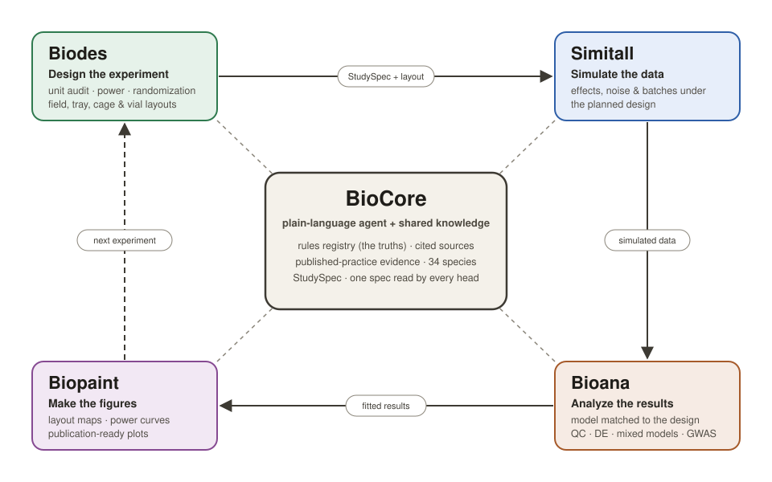

# Bioana

**Analyse the experiment the way it was designed.** Bioana is the analysis head of a small suite of free,
offline tools for plant and biological research. It reads a Biodes design folder filled with data (simulated
by Simitall or measured by you), picks the model that matches the design, runs it with published R packages,
and, when the data were simulated, scores every result against the known truth.

**Free for everyone. No API key, no account, works offline.** Every number comes from a published package
(DESeq2, edgeR, limma, lme4, survival, rrBLUP, ...). Bioana's own code runs only when you allow it, and the
report then says so.

<p align="center">
  
</p>

## The suite

One shared core, four heads. Each head reads the same StudySpec, so the design, the simulation, the analysis
and the figures can't contradict each other.

| Part | Job | Status |
|---|---|---|
| **[BioCore](https://github.com/nirwan1265/BioCore)** | Plain-language agent, the rules registry, published-practice evidence, the shared StudySpec, and the app (design, simulate, analyse from one text box) | In progress |
| **[Biodes](https://github.com/nirwan1265/BioDesignGPT)** | Design: unit audit, candidate designs, power, randomization, layouts | Available |
| **[Simitall](https://github.com/nirwan1265/simitall)** | Simulate data under the planned design with known truth | Available |
| **Bioana** (this repo) | Analyse with the model that matches the design, and score it against Simitall's truth | Available |
| **Biopaint** | Figures | In progress |

Worked examples (a question taken through design, simulation and analysis) are in
[BioCore](https://github.com/nirwan1265/BioCore).

## What Bioana does

1. **Reads the Biodes folder:** `study_spec.json` (design, `analysis.model`, goals, outcome type, covariates,
   strata), `field_layout.csv`, `sample_metadata_template.tsv`, and `data_manifest.json`, which lists each
   data set and its files. It never reads the original question and never simulates: simulated and measured
   data go through the same code.
2. **Picks the model that matches the design.** The design's `analysis.model` is fitted as written: blocks,
   split plots, repeated measures, subsamples and random terms included. The test follows the study's goal
   (treatment effect, interaction, time course, trend, regression slope, association, survival).
3. **Runs it with published packages.** Two rule tables choose the package per data type and design:
   `inst/rules/engines.tsv` and `inst/rules/engine_selection.tsv`. The first installed engine is the primary;
   `secondary = TRUE` also runs the next one and reports how well they agree.
4. **Falls back to its own code only when allowed, and says so.** With `allow_fallback = FALSE` (the
   default), a missing package stops the analysis and names what to install. With `allow_fallback = TRUE`,
   Bioana's own implementation runs and is marked `FALLBACK` in the report and in `engine$fallback`. An engine
   that only approximates the design is marked "approximates the design".
5. **Checks the design before fitting**: confounding, no residual df, pseudoreplication. It refuses rather
   than fit the wrong model (see Safeguards).
6. **Scores against the truth.** When the folder comes from Simitall, each result is compared with
   `sim_truth.json` and the truth tables:
   - found vs planted (true and false positives, FDR);
   - estimates vs true effects, with CI coverage;
   - the study goal: detected, estimate vs true effect;
   - per-group truth for categorical and survival outcomes.

## What it analyses

| Analysis | Data | Packages |
|---|---|---|
| Linear and mixed models | continuous outcome; blocks, split plots, repeated measures, subsamples | stats `lm`, lmerTest, afex (ANOVA with sphericity corrections), emmeans (post-hoc) |
| Group tests next to the model | t-tests, Welch, Wilcoxon, Kruskal-Wallis, Friedman, ANOVA with checks (normality, equal variances, outliers) | stats, rstatix, car, effectsize |
| Robust tests | trimmed means: Yuen, robust one-way / two-way / repeated / mixed ANOVA; robust correlation | WRS2 |
| Regression | linear and logistic with measured covariates; ANCOVA, interactions, predictions, diagnostics (VIF, influence, Breusch-Pagan, RESET, Box-Tidwell, Hosmer-Lemeshow, AUC) | stats, car, lmtest, sandwich, emmeans, pROC, robustbase |
| Categorical outcomes | binary, ordinal, nominal; chi-squared, Fisher, McNemar, Cochran's Q, Cochran-Mantel-Haenszel, trend tests, goodness of fit to an expected ratio (segregation) | stats, lme4, ordinal, nnet, epitools |
| Count outcomes | Poisson / negative binomial, with random terms | MASS, lme4, glmmTMB |
| Survival | Kaplan-Meier, log-rank (weighted, stratified, cluster-robust), Cox and mixed Cox, RMST, AFT, delayed effects, life tables, competing risks (CIF, Gray, Fine-Gray) | survival, coxme, cmprsk, KMsurv |
| Correlation and agreement | trait correlations (raw and within the design); Cohen's / Fleiss' kappa, ICC | stats, vcd, psych, irr |
| RNA-seq and other counts | gene, miRNA, taxon, pseudobulk counts | DESeq2, edgeR, limma-voom, dream (random terms) |
| Chromatin | ChIP / CUT&Tag peaks, ATAC windows | edgeR (as csaw), DESeq2, dream |
| Methylation | bisulfite counts (WGBS, RRBS), arrays (450k / EPIC) | DSS, limma |
| IP / input | m6A MeRIP, MeDIP, RIP | edgeR (IP x treatment), limma |
| GWAS | line means from the design's model, then a kinship mixed-model scan | rrBLUP, GAPIT |

`bioana_analyses()` lists the data types (`inst/rules/analyses.tsv`). A new data type is a row there plus one
method.

## Engines

Per data type, in order (the first installed one runs; `max_random` decides which can hold random terms):

| Data | Fixed design | Random terms (same units over time, split plots, ...) |
|---|---|---|
| gene / miRNA / taxon counts | DESeq2 -> edgeR -> limma-voom | dream -> limma-voom + duplicateCorrelation |
| ChIP peaks, ATAC windows | edgeR -> DESeq2 | dream -> limma-voom |
| bisulfite counts | DSS -> limma on M-values | limma on M-values |
| methylation arrays | limma | limma + duplicateCorrelation |
| m6A / MeDIP / RIP | edgeR IP x treatment -> limma on log2(IP/input) | limma |
| continuous outcome | lm | lmerTest -> glmmTMB |
| binary / count / ordinal / nominal outcome | glm, glm.nb, clm / polr, multinom | glmer, glmer.nb, clmm -> glmmTMB |
| survival outcome | coxph | coxme -> coxph with a gamma frailty (approximation) |
| genotypes | rrBLUP -> GAPIT MLM | kinship random effect |

```r
bioana_engines()                                      # the registry, with what is installed
bioana_engine_plan("feature_counts", "random")        # what would run for a repeated-measures RNA-seq design
bioana_analyze(dir, params = list(rnaseq = list(engine = "edger")))   # choose an engine
```

Each engine's tutorial and its gold-standard check (Bioana's adapter gives the same numbers as the package
called directly) are in [docs/engines/](docs/engines/README.md).

## Analysis goals: what is tested

Biodes writes the goal of the study into `study_spec.json` (`analysis.goals`,
`analysis.primary_goal`, `analysis.goal_terms`; contract:
[docs/contracts/analysis_goals.md](docs/contracts/analysis_goals.md); the vocabulary lives in Biodes'
`inst/registry/analysis_goals.json`). `engine_selection.tsv` is keyed by goal (`goals` column) and each
engine says which tests it can run (`engines.tsv` `tests`: `wald`, `lrt`).

| goal | test | how |
|---|---|---|
| `treatment_effect` (default) | Wald on the `goal_terms` coefficients (adjustment factors excluded) | every engine |
| `interaction` | Wald if one coefficient, joint test if several | DESeq2 LRT (reduced: without the interaction), edgeR QL F, limma/voom/dream moderated F, outcome `anova(reduced, full)` |
| `time_course` | joint test: the model without every term containing time | same engines |
| `trend` | Wald on the slope of a numeric term | the term is fitted as numeric |
| `association` | per marker | GWAS engines |
| `regression` | Wald on each covariate's slope (odds ratio for yes/no outcomes) | lm, glm |
| `survival` | Wald / log-rank; with non-proportional hazards the prespecified weighted log-rank and a piecewise Cox fit | coxph, coxme |

Engines without a joint test (DSS, the IP x input model) are skipped for joint-test goals. With no goal
in `study_spec`, Bioana tests treatment effects and says so when the model has time or interaction
terms. `bioana_goals()` lists what is available per data type; `params = list(<id> = list(goal = ...))`
picks one. Each analysis records its goal, test and the coefficients tested in `summary$...$goal`;
outcome joint tests go to `goal_test.tsv`.

## Safeguards: what Bioana refuses to do

Before fitting a data set Bioana checks the design (`bioana_check_design(dir)` runs the same checks on
the whole sample sheet; thresholds in `inst/rules/design_checks.json`). It **stops** when:

- a treatment coefficient is confounded with another term (e.g. every control in one batch);
- there are no residual degrees of freedom;
- a subject (plant, animal, donor, ...) is measured more than once but `analysis.model` has no random term
  for it: the samples would be treated as independent when they are not;
- several libraries come from one unit under the same treatment (technical replicates);
- a random term has one observation per level, or one level;
- a count matrix holds normalised values (CPM, TPM), or the outcome values do not match its type
  (binary not 0/1, negative counts, survival events not 0/1).

It **warns** (in the report and `summary$diagnostics`) about few residual df, treatment levels with one
unit, random terms with few levels, and every warning a package raised while fitting (singular fits,
DESeq2 genes that did not converge, glmmTMB Hessian problems).

It **never swaps in a method that does not fit the design**. Every engine row in
`engine_selection.tsv` says how it fits the design (`design_fit`): `full`, `approx` (e.g. limma
duplicateCorrelation for one random intercept instead of dream's mixed model; marked "approximates the
design" in the report) or `drops_random` (only with `allow_fallback = TRUE`; marked "RANDOM TERMS
DROPPED"). An engine that cannot hold the design's random terms (`max_random` in `engines.tsv`) is
skipped. If an engine fails while fitting, the next one runs only if it fits the design fully;
otherwise the analysis stops and says which engine you could choose yourself.

## What it writes

`<folder>/bioana/`, one folder per data set (`<id>/`):

- `results.tsv`: outcome, one row per coefficient (`term, estimate, se, df, statistic, p, role, padj`);
  features, one row per feature and contrast (`feature_id, contrast, estimate, se, statistic, p, padj`);
  genotypes, one row per marker.
- `results_<engine>.tsv`: the secondary engine, with `secondary = TRUE`.
- Analysis tables:
  - group tests: `stat_tests.tsv`, `posthoc.tsv`, `descriptives.tsv`;
  - regression: `regression_*.tsv`;
  - survival: `survival_summary.tsv`, `landmarks.tsv`, `km_curve.tsv`, `cif_curve.tsv`;
  - other: `correlation.tsv`, `agreement.tsv`, `line_means.tsv`.
- Truth scoring (simulated data):
  - outcome: `recovery.tsv`;
  - GWAS: `qtn_recovery.tsv`;
  - per-group truth: `group_probability_recovery.tsv`, `survival_group_recovery.tsv`;
  - other: `correlation_recovery.tsv`, `agreement_recovery.tsv`, `ratio_recovery.tsv`.
- `bioana_summary.json`: everything below, for apps and Biopaint.

`bioana_analyze()` returns `list(summary, results, recovery, fits, paths)`. These fields are kept stable for
apps (BioCore reads them); renaming one is announced first:

| Field | Contents |
|---|---|
| `summary$analyses[[id]]$engine` | package, version, exact call, formula, model, test statistic, multiple testing, experimental unit, `fallback`, how it fits the design |
| `summary$analyses[[id]]$goal_recovery` | the study goal against the truth: test, p, detected, estimate, true effect, CI coverage (and per data type: slopes, odds ratios, class probabilities, hazard ratios per phase, group measures) |
| `summary$analyses[[id]]$recovery` | feature or marker recovery (true and false positives, FDR, sign agreement), or correlation / agreement recovery |
| `summary$analyses[[id]]$goal`, `$stat_test`, `$regression`, `$warnings` | the goal and test, the group tests, the regression layer, every warning raised |
| `result$results[[id]]`, `result$recovery[[id]]` | the results table and the recovery table as data frames |

## Install

```r
# install.packages("remotes")
remotes::install_github("nirwan1265/bioana")
```

With every engine (from a clone):

```bash
git clone https://github.com/nirwan1265/bioana && cd bioana
Rscript install_bioana.R            # bioana + engines, readers, genetics (the "analysis" profile)
Rscript install_bioana.R full       # + plots and test tools;  "suite" adds Simitall
```

Or from R: `bioana_install_dependencies("analysis")`, and `bioana_check_dependencies()` to see
what is missing. Every package Bioana uses, with its source (CRAN, Bioconductor, GitHub) and what it is
for, is in `inst/rules/requirements.tsv`.

## Use it

```r
library(bioana)

# a folder from Biodes, filled by Simitall (or by you)
res <- bioana_analyze("path/to/folder")                     # prints one block per data set
res <- bioana_analyze("path/to/folder", quiet = TRUE, secondary = TRUE, allow_fallback = TRUE)

res$summary$analyses$outcome$goal_recovery                   # the goal, graded against the truth
head(res$results$outcome)                                    # the fitted model's table
res$summary$analyses$outcome$engine$package                  # which package produced it

bioana_check_design("path/to/folder")                        # the design checks alone
bioana_goals()                                               # goals available per data type
```

## Your own data

For real data the flow is **Biodes -> Bioana** (Simitall is not needed).
Biodes describes the experiment you ran and writes the design folder (the
`biodes_from_data()` contract: [docs/contracts/biodes_from_data.md](docs/contracts/biodes_from_data.md)).
Then:

```r
bioana_manifest_from_files(dir, c("featurecounts.txt", "genotypes.vcf"), assay = "rnaseq")
bioana_analyze(dir)
```

A worked real example, the DESeq2 vignette's airway data (built the way
Biodes' describe-my-data mode should write it):

```r
d <- bioana_example("airway")      # 4 cell lines x dexamethasone, Himes et al. 2014
bioana_analyze(d, secondary = TRUE) # DESeq2 (= the vignette, checked in test-real-airway.R), edgeR as secondary
```

`bioana_manifest_from_files()` detects each file's format, converts it to
Bioana's files under `<dir>/data/<id>/`, matches sample names to
`sample_id` (BAM paths and tool suffixes are stripped), and writes
`data_manifest.json` with the source files and tool recorded.

| format | detected by | becomes |
|---|---|---|
| BAM (one per library) | file name | reads counted with **Rsubread featureCounts** in genes (`annotation` = GTF), peaks (SAF or peak files) or exon windows (IP/input assays); `libraries` says which file is which unit and library (`chip`, `control`, `ip`, `input`); single-end ChIP reads extended to 125 bp fragments as DiffBind does |
| featureCounts | `# Program:featureCounts` or its columns | counts: `feature_counts`, or peaks for ChIP/ATAC/CUT&Tag assays |
| Salmon `quant.sf`, kallisto `abundance.tsv` (one folder per sample) | columns | gene counts via **tximport** (`tx2gene`, `lengthScaledTPM`) |
| STAR `ReadsPerGene.out.tab` | `N_unmapped` rows | counts; strandedness detected or given |
| Bismark `.cov` / cytosine report (one file per sample) | line pattern | `bisulfite_counts` (context kept from reports) |
| VCF | `##fileformat=VCF` | `genotypes` |
| HapMap (`.hmp.txt`, TASSEL / GAPIT) | `rs#  alleles  chrom  pos` header | `genotypes` (converted to VCF) |
| DSS / BSmooth text (`chr pos N X`, one per sample) | columns | `bisulfite_counts` |
| plain feature x sample table | file type | integers: counts; 0-1: `methylation_beta`; `<id>_IP` / `<id>_input` columns: `ip_input_counts` |
| MACS narrowPeak / broadPeak | file name | peak calls have no counts: `bioana_consensus_peaks()` writes a SAF to count with `featureCounts -F SAF` |

Formats live in `inst/rules/file_formats.tsv` (pattern, header, columns,
reader) and `file_formats.json` (sample-name rules, assay -> data type). A new
format is a row and a reader. Normalised values (TPM, CPM) are refused: the
engines need raw counts.

### Checked on real data

`tests/testthat/test-real-data.R` runs published data sets through Bioana. The
data live in [bioana-testdata](https://github.com/nirwan1265/bioana-testdata);
set `BIOANA_TESTDATA` or clone it next to `bioana/`.

| data | check | result |
|---|---|---|
| airway counts (DESeq2 vignette) | Bioana = vignette code | log2FC to 5e-9; known dexamethasone genes up |
| airway BAMs + GTF | featureCounts = the package's counts | median ratio 1, r = 0.998 |
| DiffBind tamoxifen ChIP, chr18 1-20 Mb | Bioana's DB calls vs DiffBind's own (DESeq2) | 91-96% of Bioana's calls are DiffBind's, same direction at every one; DiffBind calls more sites (it subtracts input reads, which raises its folds about 1.5x) |
| maize 282 panel, 2 locations (TASSEL) | line means; GWAS = rrBLUP called directly | r = 0.97 with TASSEL's line values; -log10 p to 1e-11 |
| DSS example counts | Bioana at site level = DSS called directly | identical statistics, same 247 DML |
| bsseq Bismark files | formats read | coverage and cytosine report |
| exomePeak2 MeRIP BAMs | windows, IP/input pairing, model runs | runs; too small for a differential check |

## The link to Simitall: `data_manifest.json`

```json
{
  "manifest_version": "0.1",
  "written_by": "simitall 0.2.0",
  "data": [
    {"id": "outcome", "data_type": "outcome", "files": {"table": "sample_metadata_template.tsv"},
     "column": "primary_outcome", "outcome_type": "continuous",
     "truth": {"kind": "outcome", "file": "sim_truth.json"}},
    {"id": "rnaseq", "data_type": "feature_counts", "assay": "rnaseq", "files": {"counts": "counts.tsv"},
     "truth": {"kind": "features", "file": "truth/rnaseq.tsv", "term": "treatment", "large": 1}},
    {"id": "methylation", "data_type": "bisulfite_counts", "assay": "methylation",
     "files": {"sites": "methylation/methylation.sites.tsv.gz", "methylated": "...", "coverage": "..."},
     "truth": {"kind": "regions", "file": "truth/methylation.tsv", "term": "treatment"}}
  ]
}
```

Each simulated data type in Simitall maps to one `data_type` here; a new
simulator in Simitall adds a manifest entry, and a new analysis here adds a
row to `analyses.tsv`. Truth files: `features` = `feature_id, condition,
effect`; `regions` = `region_id, chr, start, end, condition, effect`; the
tested contrast is `term` + `condition` (e.g. `treatmenttreatment_2`).

## Other analyses (moved from Simitall)

These work on files directly (Simitall's simulator outputs or the same formats
from real data) and are not yet wired into `bioana_analyze()`:

| area | functions |
|---|---|
| GWAS | `analyze_gwas()` (mixed model with kinship and PCs, rrBLUP), `analyze_binary_gwas()`, `benchmark_gwas()` (recovery of causal variants), `plot_gwas_results()` (Manhattan, QQ) |
| Genomic prediction and selection | `calculate_genomic_kinship()`, `fit_genomic_model()` (GBLUP, RR-BLUP, BGLR Bayesian models, random forest), `predict_genomic_values()`, `cross_validate_genomic_prediction()`, `select_parents()`, `design_parent_crosses()`, `run_genomic_selection()` |
| eQTL and RNA-seq | `benchmark_eqtl()`, `benchmark_celltype_eqtls()` (donor pseudobulk per cell type), `summarize_rnaseq_results()`, `plot_rnaseq_eqtl_results()` |
| Single cell | `cluster_scrnaseq()`, `score_scrnaseq_clusters()`, `test_scrnaseq_conditions()`, `score_scrnaseq_conditions()`, `plot_scrnaseq_results()` |
| ChIP / ATAC peaks | `call_peaks_windowed()`, `score_peak_calls()`, `test_differential_peaks()`, `score_differential_peaks()`, `plot_chipseq_results()` |
| Genes and GO | `read_gene_coordinates()` (bundled catalogues: Arabidopsis, barley, rice, wheat, maize, fly), `read_go_gaf()`, `join_gene_go()`, `summarize_go_terms()` |
| Genome assembly | `run_unicycler_grid()`, `run_quast_grid()`, `summarize_quast()` |
| Figures | `export_bioana_plot_panels()` saves each panel of a results figure |

```r
g <- bioana::analyze_gwas("cohort.vcf", phenotypes, "gwas_out", trait = "yield", n_pcs = 3)
bioana::benchmark_gwas(g$paths$results, "cohort.causal.tsv")
fit <- bioana::fit_genomic_model("cohort.geno.tsv", phenotypes, trait = "yield", model = "gblup")
```

## Roadmap


Each needs an analysis here, a row in `inst/rules/analyses.tsv`, a test, and
(for simulated data) the matching Simitall manifest entry. "Questions" = how
many of Biodes' 4,695 paper questions need it.

**Wire existing functions into `bioana_analyze()`**

- [x] `genotypes`: GWAS / QTL mapping with `analyze_gwas()` on the design's
      line means, scored with `benchmark_gwas()` against `genetic_truth/qtn_truth.tsv`.
      Next for it: GWAS per environment under GxE, ordinal and survival outcomes,
      QTL mapping with cross-aware genotype probabilities.
- [x] Real data readers: featureCounts, Salmon/kallisto (tximport), STAR, Bismark, VCF, plain
      tables, MACS peak calls (consensus SAF); `bioana_manifest_from_files()`. Still to do: BAM
      input (counting, exomePeak2) and a run on Simitall's real templates.
- [ ] eQTL designs: `benchmark_eqtl()` on `counts.tsv` + `genotypes.vcf`.
- [ ] Single cell at cell level: `cluster_scrnaseq()`, cell-type proportions,
      `test_scrnaseq_conditions()`; cell-type eQTL.
- [ ] Peaks: `call_peaks_windowed()` + `test_differential_peaks()` as the
      peak-calling alternative to fixed windows for ChIP / ATAC.
- [ ] Genomic prediction for breeding designs (`fit_genomic_model()`,
      `cross_validate_genomic_prediction()`), scored against the true genetic values.

**Analyses for data types Simitall will simulate**

- [ ] Metabolomics / lipidomics (54 questions): log intensities, missing
      values, moderated t; pathway / class summaries.
- [ ] Genetics with no lines (36): BSA / QTL-seq (allele-frequency difference
      between bulks, G' statistic), pool-seq (allele frequencies over
      generations), population scans (Fst, selection).
- [ ] Ribo-seq (42): translational efficiency, the RNA x footprint interaction.
- [ ] scATAC-seq (41): peaks x cells, cluster-level differential accessibility.
- [ ] Hi-C (38): differential contacts, loops and TAD boundaries.
- [ ] MeDIP (31) and RIP/CLIP (14): already `ip_input_counts`; check on their
      simulated data.
- [ ] Degradome (22): cleavage sites and miRNA targets.
- [ ] Spatial (19): spatially variable genes, domains.
- [ ] MNase-seq (16): nucleosome positions and occupancy changes.
- [ ] CRISPR screens: guide-level counts to gene scores (MAGeCK-like).
- [ ] Amplicon genotyping: editing efficiency, allele frequencies per sample.
- [ ] TCR/BCR repertoires: clonotype abundance and diversity.
- [ ] Proteomics: log intensities with missing values (limma-like).
- [ ] STARR-seq / MPRA: RNA over DNA barcode counts per element.
- [ ] Compositional outcomes.
- [ ] A small-sample rule for RNA-seq: DESeq2's Wald test is liberal at few residual df (8% at p < 0.05 with
      9 df, against 5% for edgeR QL); open decision on the default.

**Methods and checks**

- [x] Package adapters with the native methods as fallback: DESeq2, edgeR,
      limma-voom, limma, dream, DSS, glmmTMB, rrBLUP, GAPIT (engine registry,
      selection rules, provenance, tutorials and gold checks).
- [ ] Next adapters: qtl2, muscat, csaw / DiffBind, ANCOM-BC2 / ALDEx2,
      exomePeak2 (BAM), methylKit, MSstats / proDA, clusterProfiler / fgsea,
      mixOmics; then Python engines (Scanpy/scVI-tools, PyDESeq2, statsmodels,
      scikit-learn, COBRApy).
- [x] Random terms in feature tests: dream (any lme4 terms) or limma
      duplicateCorrelation (one grouping term).
- [ ] Contrasts beyond "each level vs the reference": pairwise and interaction
      contrasts for multi-level factors.
- [ ] Power for every data type: Simitall's power sweep uses Bioana's scores
      for the outcome and counts; add methylation (DMRs), m6A, peaks, GWAS.
- [ ] QC and normalisation reports for real data.
- [ ] Check low power where the simulation says so: small RNA and microbiome
      templates vary a lot between real samples (0 found with 5 per group);
      m6A at 5 per group (2/40).

## Status

Version 0.14 (`NEWS.md`). Tested on synthetic folders, on Simitall output and on published data
(`devtools::test()`, with `BIOANA_TESTDATA` for the real-data tests). How the code is organised and the
contracts with Biodes and Simitall: `AGENTS.md` and `docs/contracts/`.

Links: [Biodes](https://github.com/nirwan1265/BioDesignGPT) ·
[Simitall](https://github.com/nirwan1265/simitall) · [BioCore](https://github.com/nirwan1265/BioCore)
