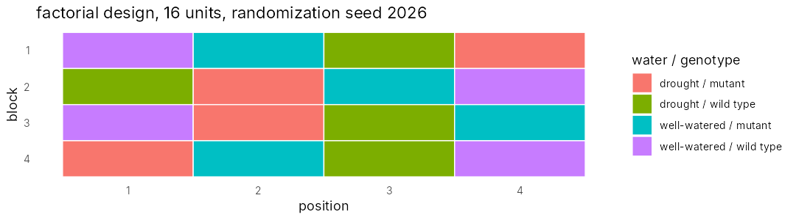
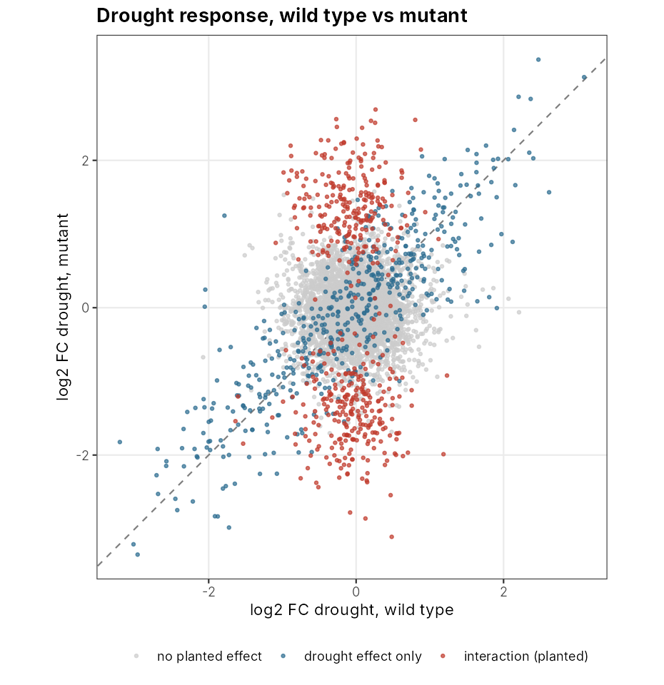

# 02 RNA-seq: genes whose drought response differs between genotypes

*Above: the layout Biodes designed (16 plants in 4 blocks) and the drought responses Simitall planted. Overview of all three examples, with the R code and output: [../README.md](../README.md).*

**Question** (to Biodes): "RNA-seq of leaves from wild type and mutant Arabidopsis under drought and
well-watered conditions, 4 plants per genotype per treatment; we want genes whose drought response differs
between genotypes."

Design: [Biodes](https://github.com/nirwan1265/BioDesignGPT/tree/main/examples/showcase/02_rnaseq_drought) ·
data and truth: [Simitall](https://github.com/nirwan1265/simitall/tree/main/examples/showcase/02_rnaseq_drought)
(5,000 genes: 500 respond to drought in both genotypes, `truth/rnaseq.tsv`; 500 respond differently in the
mutant, the goal, `truth/rnaseq_goal.tsv`) · figures: Biopaint (planned).

## Model

DESeq2 (default engine), `~ treatment * treatment2 + block` (drought x genotype, 4 blocks), Wald test of the
`treatmentdrought:treatment2mutant` coefficient (the difference of the drought responses, log2), Benjamini-Hochberg
FDR 0.05. edgeR quasi-likelihood was run on the same model as the second engine.

## Result

273 genes with a genotype x drought interaction at FDR 0.05 (`results/results.tsv`).

## Against the truth

| Engine | Called | Goal genes found (of 500) | Drought-only genes called | No planted effect | p < 0.05 at genes with no effect |
|---|---|---|---|---|---|
| DESeq2 (default) | 273 | 215 (0.43) | 7 | 51 (19% of calls) | 8.3% |
| edgeR QL | 91 | 89 (0.18) | 1 | 1 (1% of calls) | 5.4% |

The goal genes DESeq2 misses have smaller planted interactions (median |log2| 1.28, against 1.50 for those found).

DESeq2 finds more than twice as many goal genes, but one call in five has no planted effect: four times the
5% the FDR promises. With 16 samples and 7 coefficients the residual df is 9, and at that size DESeq2's Wald test
is liberal (8.3% of genes with no effect reach p < 0.05). edgeR's quasi-likelihood F test holds its level (5.4%)
and its calls are clean, at the cost of power. For a design this small, report both, or use edgeR QL for
the interaction. Bioana's default for small RNA-seq designs is an open decision (Bioana AGENTS.md).

## results/

`results.tsv` (DESeq2: estimate, SE, Wald statistic, p, adjusted p per gene), `interaction_calls.tsv` (per gene:
the planted class, the true interaction, DESeq2's and edgeR's estimate and adjusted p), `report.txt`,
`bioana_summary.json`, `truth_recovery.json`. For Biopaint: a volcano plot of the interaction coloured by planted
class, and estimate vs true interaction for the goal genes.
