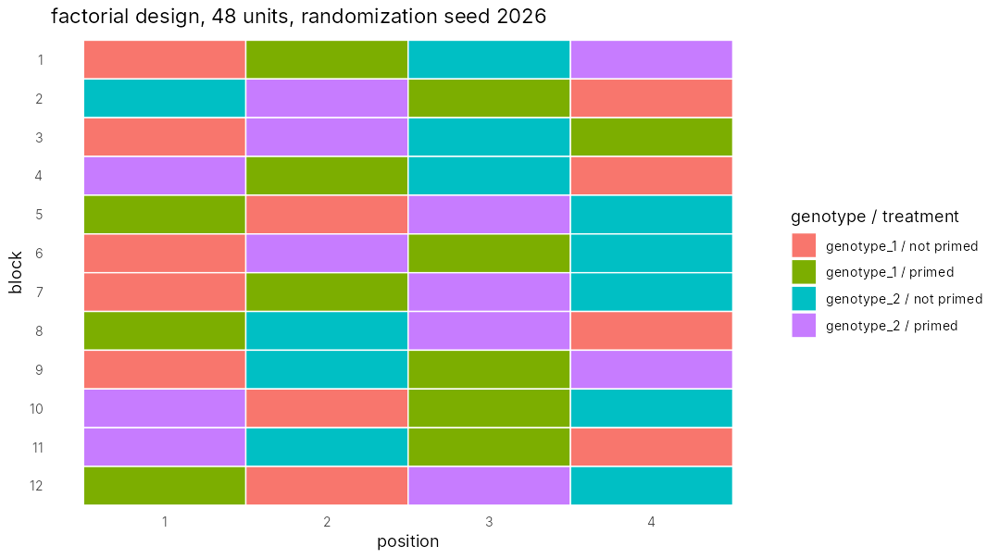
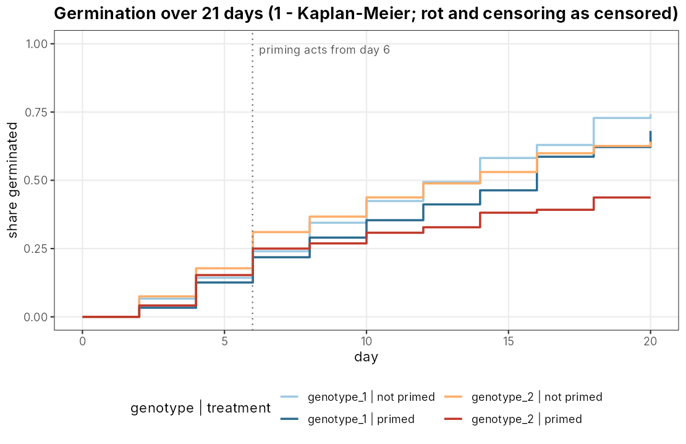

# 03 Seed priming: time to germination with a delayed effect and seed rot

*Above: the tray layout Biodes designed (12 trays x 4 combinations) and the germination curves Simitall simulated. Overview of all three examples, with the R code and output: [../README.md](../README.md).*

**Question** (to Biodes): "Seeds of 2 sorghum lines primed or not in 12 trays in a growth chamber, 10 seeds
per treatment per tray, days to germination checked every 2 days, followed for 21 days; seed rot can occur
before germination; the priming effect is delayed; hazard ratio 0.6; germination by day 7 and 14."

Design: [Biodes](https://github.com/nirwan1265/BioDesignGPT/tree/main/examples/showcase/03_germination_survival) ·
data and truth: [Simitall](https://github.com/nirwan1265/simitall/tree/main/examples/showcase/03_germination_survival)
(480 seeds; hazard ratio 0.6 after day 6 for priming and for line 2 alike, no interaction; seed rot as a
competing event, code 2; tray and cell frailty; censoring at day 21) · figures: Biopaint (planned).

## Model

- Cox, cause-specific for germination (seed rot censored), `treatment * treatment2 + (1 | block)` with the
  48 tray x treatment cells as a shared frailty for their 10 seeds (coxme).
- Kaplan-Meier per line x priming group, log-rank (plain, stratified by tray, cluster-robust), and the
  prespecified Fleming-Harrington FH(0,1) weighted log-rank (weights late differences, for a delayed effect).
- Competing risks: cumulative incidence (CIF), Gray's test, Fine-Gray (cmprsk).
- For the delayed effect: a piecewise Cox fit split at the change day (6), one hazard ratio before and one
  after for each factor, robust SEs by cell.

## Result

| | |
|---|---|
| Weighted log-rank FH(0,1), 4 groups | chi-squared(3) = 23.2, p = 3.6e-5 |
| per factor, stratified on the other | line p = 0.0002, priming p = 0.015 |
| Plain log-rank / cluster-robust score test | p = 0.0032 / p = 0.045 |
| Kaplan-Meier median, days | 14, 14, 16, not reached (line 1 / 2, not primed / primed) |
| Proportional hazards (cox.zph) | rejected, p = 0.002 |

The Cox hazard ratios (line 0.91, priming 0.83) average the two phases, so none is significant on its own. That
is why the delayed effect needs the weighted log-rank and the piecewise fit. The FH(0,1) test treats the seeds
as independent. They share tray and cell frailties, so its p-value is too small; the cluster-robust score test
(p = 0.045) is the honest p-value for the clustering. Seed rot does not differ between groups (Gray's test
p = 0.40). One minus Kaplan-Meier overstates germination by day 14 (0.49 against a CIF of 0.45).

## Against the truth

Hazard ratio after day 6 (piecewise Cox), true 0.6:

| Factor | Estimate | 95% CI | Covered | HR before day 6 |
|---|---|---|---|---|
| line 2 vs line 1 | 0.630 | 0.454 to 0.873 | yes | 1.25 |
| primed vs not | 0.667 | 0.488 to 0.911 | yes | 0.84 |

Per group (`results/survival_group_recovery.tsv`): 23 of 24 measures are in their 95% CI. The 24 are the median
of germination alone, event-free survival at days 7 and 14, cumulative incidence of germination at days 7 and 14,
and event-free RMST to day 21, for each of the 4 groups.
- **Truth used:** Simitall's `marginal` values, the curves averaged over the trays' and cells' random
  differences, which is what the pooled data show. The conditional values (an average tray) are in the
  `true_conditional` column.
- **Check grid:** germination was checked every 2 days, so each seed germinated sometime in the 2 days before
  it was found. Bioana reads the curves between checks by linear interpolation and integrates RMST with the
  trapezoid rule; Kaplan-Meier alone would put every germination at the check, up to 2 days late.
- **The miss:** event-free RMST of line 1 primed, 11.8 days against 10.5 (CI 10.7 to 12.9). It does contain
  the conditional value, 11.7.
- **Median not reached:** line 2 primed reaches half germinated only at the very end of follow-up. Its
  interval starts at 16.4 days and stays open, so it contains the truth (16.6 marginal).
- **Intervals:** they treat seeds as independent, so with tray and cell effects they are a little too narrow.

## results/

`results.tsv` (Cox coefficients), `stat_tests.tsv` (log-rank family, Cox HRs, RMST), `survival_summary.tsv`
(medians, quartiles, RMST), `landmarks.tsv` (survival at days 7 and 14), `km_curve.tsv`, `cif_curve.tsv`,
`competing_table.tsv` (Gray, Fine-Gray), `posthoc.tsv` (pairwise log-rank), `survival_group_recovery.tsv`,
`report.txt`, `bioana_summary.json`, `truth_recovery.json` (piecewise HRs, per-factor weighted log-rank, group
recovery). For Biopaint: Kaplan-Meier curves with the day-6 change marked, CIF curves for germination and rot,
and estimated vs true group measures.
