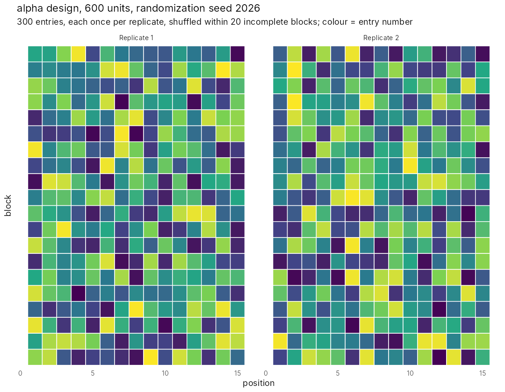
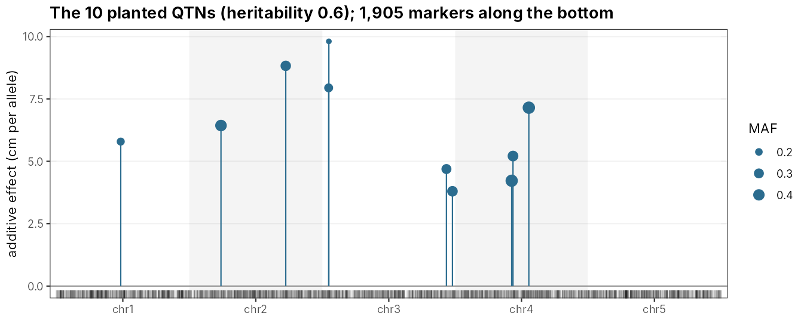
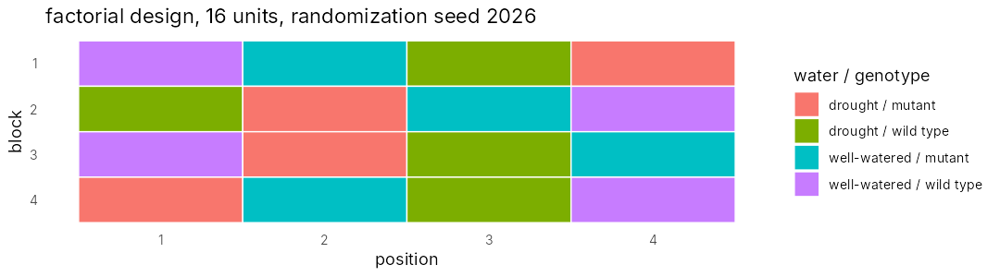
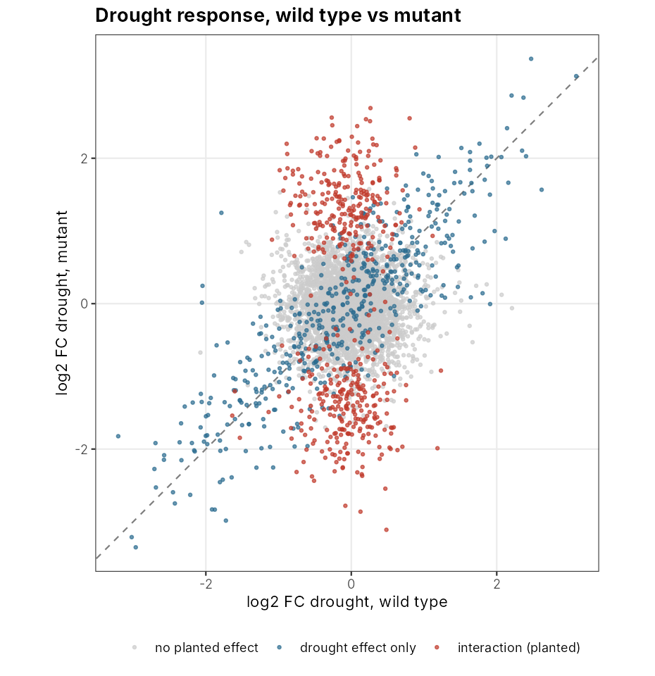
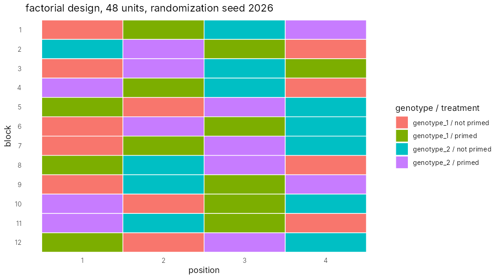
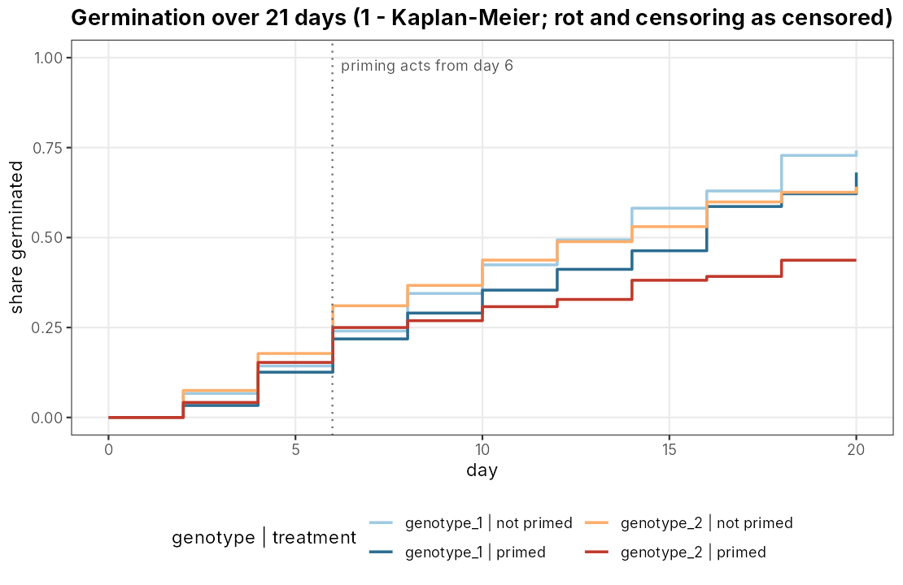

# From a question to an answer: three worked examples

A researcher types a question in plain words. Three tools take it from there:

| Step | Tool | What it does |
|---|---|---|
| 1. Design | [**Biodes**](https://github.com/nirwan1265/BioDesignGPT) | turns the question into a randomized experimental design: layout, sample sheet, statistical model, sample size |
| 2. Simulate | [**Simitall**](https://github.com/nirwan1265/simitall) | creates realistic data for that exact layout, with effects whose true size is known ("the truth") |
| 3. Analyse | **Bioana** (this repository) | analyses the data with the standard R package for that kind of data, then checks its answer against the truth |

Because the truth is known, every analysis is graded: did it find the real effects, did it report effects
that are not there, and how close are its estimates? The same check works on real data, minus the grading.

The three examples below were run end to end. Everything is reproducible with seed 2026, and the folder names
are the same in all three repositories.

| | Question | Answer from Bioana | Graded against the truth |
|---|---|---|---|
| [01](#01-which-genes-control-plant-height-in-sorghum) | Which DNA markers control plant height in 300 sorghum lines? | 6 markers | 6 of the 10 real genes found, no false hits |
| [02](#02-which-genes-respond-differently-to-drought-in-a-mutant) | Which genes respond to drought differently in a mutant? | 273 genes | 215 of 500 real genes found; 1 in 5 calls is a false hit |
| [03](#03-does-seed-priming-delay-germination) | Does seed priming slow germination, given that the effect starts late? | yes: germination about a third slower after day 6 | true slowdown 40%; 23 of 24 group summaries correct |

---

## 01 Which genes control plant height in sorghum?

> *"GWAS of plant height in 300 sorghum accessions grown in an alpha lattice with 2 replicates at one location
> in one season."*

**Step 1: Biodes designs the field trial.** 300 lines, each planted twice (2 replicates), in small blocks of
15 plots so that soil differences can be removed (an alpha lattice). Each colour is one line:



**Step 2: Simitall simulates the data.** 300 inbred lines genotyped at 1,905 DNA markers, with population
structure like a real panel. Ten markers are made truly causal (the QTNs below, effect in cm per allele), and
60% of the variation in height is genetic (heritability 0.6). Height is then generated plot by plot for the
layout above.



**Step 3: Bioana analyses it.** First, one adjusted height per line from the field model
(`height ~ line + replicate + (1 | block)`). Then a genome-wide scan: a mixed model that corrects for relatedness
(kinship) and population structure (3 principal components), using rrBLUP. A false-discovery rate of 5% sets
the cut-off.

```r
library(bioana)
res <- bioana_analyze("01_gwas_sorghum")
qtn <- read.delim("01_gwas_sorghum/bioana/genetics/qtn_recovery.tsv")
qtn[, c("marker_id", "effect", "estimate", "padj", "recovered")]
```

```
  [genetics] [rrBLUP 4.6.3] 300 lines x 1905 markers tested, 6 significant; truth: 6/10 QTN found (FDR 0), sign 1, line means r 0.858

     marker_id effect estimate    padj recovered
1   chr3_48370   9.81     9.56 3.2e-07      TRUE
2  chr2_724691   8.83     8.43 5.0e-08      TRUE
3   chr3_46778   7.94     6.65 1.0e-03      TRUE
4  chr4_552758   7.15     5.18 6.9e-03      TRUE
5  chr2_238608   6.43     5.23 9.8e-03      TRUE
6  chr1_482382   5.79     4.66 5.0e-01     FALSE
7  chr4_433883   5.21     4.48 2.5e-01     FALSE
8  chr3_930637   4.69     3.63 6.9e-01     FALSE
9  chr4_423997   4.22     5.92 1.2e-03      TRUE
10 chr3_975805   3.80     2.33 1.0e+00     FALSE
```

**The answer, graded.** 6 markers pass the cut-off, and all 6 are real genes: no false hits. Of the 10 real
genes, the 5 largest were found, and 4 of the 5 smallest were missed. That is the expected limit of a
300-line panel. Each line's adjusted height correlates 0.86 with its true genetic value.
[Full results](01_gwas_sorghum)

---

## 02 Which genes respond differently to drought in a mutant?

> *"RNA-seq of leaves from wild type and mutant Arabidopsis under drought and well-watered conditions,
> 4 plants per genotype per treatment; we want genes whose drought response differs between genotypes."*

**Step 1: Biodes designs the experiment.** 2 genotypes x 2 watering treatments x 4 plants = 16 plants,
grown in 4 blocks with one plant of each combination per block:



**Step 2: Simitall simulates the data.** Read counts for 5,000 genes in the 16 plants. 500 genes respond to
drought the same way in both genotypes (blue). 500 genes respond differently in the mutant (red): these
are the answer. The rest do not respond (grey).



**Step 3: Bioana analyses it.** DESeq2, the standard for RNA-seq counts:
`counts ~ water * genotype + block`. The test is on the water x genotype interaction, i.e. "is the drought
response different in the mutant?", at a 5% false-discovery rate. edgeR was run on the same model as a second
opinion.

```r
res <- bioana_analyze("02_rnaseq_drought")
de  <- read.delim("02_rnaseq_drought/bioana/rnaseq/results.tsv")
sum(de$padj < 0.05)
head(de[order(de$padj), c("feature_id", "estimate", "p", "padj")], 5)
```

```
  [rnaseq] [DESeq2 1.42.0] {goal interaction, Wald} 5000 features tested, treatmentdrought:treatment2mutant 273 significant
      goal truth (interaction, terms treatment:treatment2): 215/500 goal features found (tpr 0.43); of 273 called, 7 with another planted effect, 51 with none (19%)

[1] 273
 feature_id estimate       p    padj
 gene_00166    -3.50 1.4e-12 7.2e-09
 gene_01294     2.79 1.5e-10 3.8e-07
 gene_03568    -3.04 2.6e-10 4.4e-07
 gene_02338     2.71 5.0e-10 5.1e-07
 gene_02804    -2.96 5.1e-10 5.1e-07
```

**The answer, graded.**

| | DESeq2 | edgeR |
|---|---|---|
| Genes called | 273 | 91 |
| Real interaction genes found (of 500) | 215 | 89 |
| False hits | 51 (19% of calls) | 1 (1%) |

DESeq2 finds more real genes, but 1 call in 5 is false: four times the 5% it promises. With only 4 plants per
group, DESeq2's test is too lenient. edgeR keeps its promise but finds fewer genes. Bioana runs both and
reports the disagreement, so the researcher sees the trade-off instead of one over-confident list. The real
genes DESeq2 misses have smaller true effects (median 1.28 against 1.50 log2 units for those found). [Full results](02_rnaseq_drought)

---

## 03 Does seed priming delay germination?

> *"Seeds of 2 sorghum lines primed or not in 12 trays in a growth chamber, 10 seeds per treatment per tray,
> days to germination checked every 2 days, followed for 21 days; seed rot can occur before germination; the
> priming effect is delayed; hazard ratio 0.6; germination by day 7 and 14."*

**Step 1: Biodes designs the experiment.** 12 trays, each holding the 4 line x priming combinations once
(10 seeds each): 480 seeds. Biodes also works out that a hazard ratio of 0.6 needs about 121 germinations to be
detected, and notes that a delayed effect calls for a weighted log-rank test.



**Step 2: Simitall simulates the data.** A germination day for each seed, checked every 2 days up to day 21.
Before day 6 everything germinates at the same rate. After day 6, priming lowers the germination rate to 60%
(hazard ratio 0.6), and so does line 2. Some seeds rot first; rotting is a competing event that prevents
germination. Trays and tray cells differ a little at random.



**Step 3: Bioana analyses it.** Survival analysis (R packages survival, coxme, cmprsk):
- Kaplan-Meier curves and median germination day per group;
- log-rank tests, including the Fleming-Harrington weighted test that Biodes chose for a late effect;
- a Cox model with tray and cell effects;
- competing-risk curves for germination vs rot;
- and, because the effect starts late, hazard ratios fitted separately before and after day 6.

```r
res <- bioana_analyze("03_germination_survival")
km  <- read.delim("03_germination_survival/bioana/outcome/survival_summary.tsv")
km[, c("group", "n", "events", "median", "rmst")]
pw <- res$summary$analyses$outcome$goal_recovery$piecewise$terms
do.call(rbind, lapply(pw, function(x) data.frame(factor = c(treatment = "line", treatment2 = "priming")[[x$term]],
  true_HR = x$true_hr, HR_after_day6 = x$estimate, CI_low = x$ci_low, CI_high = x$ci_high, HR_before_day6 = x$hr_other_phase)))
```

```
      Kaplan-Meier [survival 3.5.8] median: genotype_1 / not primed 14 [10, 16] (75/120 events); genotype_2 / not primed 14 [10, 18] (67/120 events); genotype_1 / primed 16 [14, 18] (71/120 events); genotype_2 / primed NA [18, NA] (47/120 events)
      log-rank chi-squared(3) = 13.8, p = 0.00317
      robust score chi-squared (Lin-Wei, clustered by unit)(3) = 8.04, p = 0.0453
      weighted log-rank chi-squared (fh_0_1, prespecified)(3) = 23.2, p = 3.6e-05
      Cox HR treatmentgenotype_2 0.909 [0.622, 1.33], p = 0.625
      Cox HR treatment2primed 0.83 [0.57, 1.21], p = 0.331
      ...
      Gray's test chi-squared (seed rot before germination)(3) = 2.97, p = 0.396
      goal truth (survival, terms treatment, treatment2): detected (p = 3.6e-05), estimate 0.63 vs true 0.6, in CI; ...; per group 23/24 measures in CI

                   group   n events median rmst
 genotype_1 / not primed 120     75     14 12.7
 genotype_2 / not primed 120     67     14 12.8
     genotype_1 / primed 120     71     16 13.8
     genotype_2 / primed 120     47     NA 14.9

  factor true_HR HR_after_day6 CI_low CI_high HR_before_day6
    line     0.6         0.630  0.454   0.873           1.25
 priming     0.6         0.667  0.488   0.911           0.84
```

**The answer, graded.**
- **Yes, priming slows germination.** After day 6, primed seeds germinate at 0.67 times the rate of unprimed
  seeds (95% CI 0.49 to 0.91); the truth is 0.6. Line 2 is slowed by the same amount: 0.63 against 0.6.
  Before day 6 neither differs from 1 (line 1.25, CI 0.85 to 1.83; priming 0.84, CI 0.57 to 1.25), as planted.
- **Why the late start matters.** A standard Cox model averages the two periods. It reports 0.83 for priming
  with p = 0.33, which would wrongly suggest no effect. The weighted test chosen by Biodes detects it
  (p = 0.00004).
- **Group summaries are right.** Medians, the share germinated by day 7 and 14, cumulative incidence and mean
  time to germination: 23 of 24 match the truth within their 95% confidence intervals, about what 95%
  intervals should give. Germination was only checked every 2 days, so Bioana reads the curves between
  checks instead of assuming each seed germinated on the day it was found.
- **Seed rot does not differ between groups** (p = 0.40), as simulated.

[Full results](03_germination_survival)

---

## Run it yourself

```r
# install.packages("remotes"); remotes::install_github("nirwan1265/Bioana")
library(bioana)
res <- bioana_analyze("path/to/a/folder")   # a Simitall folder, or your own data with a Biodes design
```

To rebuild all three examples from Simitall's folders, run this from the Bioana repository root:

```sh
Rscript examples/showcase/make_showcase.R
```

Each example folder has `results/` with the tables behind every number above.
